<h1 align="center">Agent Sandbox</h1>

<p align="center">
  <em>A policy-based sandbox for AI agent tool calls: declarative rules for commands, arguments, paths, environment, network, and resources, with explained decisions, OS-level enforcement where available, and a tamper-evident audit log.</em>
</p>

<p align="center">
  <a href="https://github.com/adeoluo/agent-sandbox/actions/workflows/ci.yml"></a>
  <a href="https://github.com/adeoluo/agent-sandbox/releases"></a>
  
  <a href="LICENSE"></a>
</p>

---

## Motivation

`agent-sandbox` sits between an agent and the operating system. The agent asks to run
`rm -rf build/` or read `~/.ssh/id_ed25519`; the sandbox evaluates the request against a
policy file, returns **allow or deny with the rule that decided and a reason**, runs allowed
commands under resource limits and an OS isolation backend, and appends the decision and
outcome to a hash-chained JSON Lines audit log.

It ships as a CLI (`agent-sandbox run | check | audit verify | serve | inspect`), a Rust
library, and a JSON Lines protocol over stdio so agents written in Python, TypeScript, or
any other language can call it as a subprocess.

Agents that can run shell commands are useful and risky at the same time. The usual
options are "trust the model" or "run everything in a VM". Between those sits a
**policy layer**: a reviewed, versioned file that says what a given agent profile may do,
checked on every call, with a record of what happened. This project builds that layer as a
usable tool and states explicitly which parts are enforced by the kernel and which are
enforced only by argument inspection.

## Architecture

<p align="center">
  
</p>

<sub>Legend: amber = entry points and external systems, indigo = core logic, green = data and state, blue = validation and control, grey = observability and outputs.</sub>

An agent reaches the sandbox through the CLI, the JSON Lines stdio protocol, or the Rust
library, which all call the same `Sandbox` API. The decision engine evaluates each request against
the compiled policy, resolving every path-like argument and matching argument patterns; a denial
is written to the audit log with its rule and reason. Allowed file reads and writes happen in
process with `O_NOFOLLOW` and size caps, and allowed commands run inside the child process
boundary under rlimits, a timeout, output caps, and the OS backend. Every outcome is appended to a
SHA-256 chained audit log that `audit verify` can check. Source:
[`docs/architecture/architecture.mmd`](docs/architecture/architecture.mmd); the module walkthrough
and request sequence diagram are in [`docs/ARCHITECTURE.md`](docs/ARCHITECTURE.md).

Two layers enforce the policy ([ADR 0001](docs/adr/0001-two-layer-enforcement.md)):

1. The **decision engine** checks a request before anything runs: executable allowlist
   (the binary is pinned to the one found on the policy `PATH`), per-executable argument
   allow and deny patterns, global denied arguments, filesystem rules on every argument
   that can name a path, and network heuristics. It returns the deciding rule.
2. The **child process boundary** constrains what an allowed command can do: rlimits,
   wall-clock timeout with process-group kill, output caps, a scrubbed environment, and an
   OS backend (Seatbelt through `sandbox-exec` on macOS, Landlock on Linux) that confines
   writes and network access even inside `sh -c`.

## Results

Headline numbers (details below):

- Decision latency on an Apple M1: 7.9 us p50 for a denial at the allowlist, 29.8 us p50 for
  an allowed `ls -la src`, about 10 us per additional path argument.
- Spawn overhead over a bare `Command`: about 0.8 ms without an OS backend; about 8.4 ms with
  `sandbox-exec` on macOS; no measurable extra cost for Landlock on Linux.
- All 38 adversarial agent commands denied; with an interpreter allowed, writes outside
  scratch, reads of `~/.ssh`, and TCP connects are blocked by the kernel on both CI platforms.
- 92 tests pass on `ubuntu-latest` and `macos-latest`; line coverage 95.2 percent on macOS and
  93.2 percent on Linux.

### Benchmarks

`make latency` runs [`examples/latency.rs`](examples/latency.rs): a release build, warmup,
then 20,000 decision samples and 500 spawn samples per row. `make bench` runs the
equivalent Criterion suite in [`benches/sandbox.rs`](benches/sandbox.rs).

**macOS**, Apple M1 (8 cores, 8 GB), macOS 27.0.1, Rust 1.99.1. Three runs; p50 varied by
under 1 percent between runs; the table shows the middle run.

| Operation | p50 | p95 | p99 | mean |
|---|---:|---:|---:|---:|
| decide: allow `ls -la src` | 29.8 us | 37.5 us | 73.0 us | 31.7 us |
| decide: deny unlisted `python3` | 7.9 us | 8.5 us | 17.0 us | 8.3 us |
| decide: deny `cat ~/.ssh/id_ed25519` | 24.9 us | 29.7 us | 68.0 us | 26.7 us |
| decide: allow `cat` with 9 path args | 113.4 us | 127.6 us | 184.8 us | 116.8 us |
| spawn: bare `Command::output` of `/bin/echo` | 1.12 ms | 1.64 ms | 1.87 ms | 1.19 ms |
| spawn: sandbox run, isolation off | 1.89 ms | 2.69 ms | 2.84 ms | 2.02 ms |
| spawn: sandbox run, isolation auto (`sandbox-exec`) | 10.27 ms | 10.65 ms | 10.87 ms | 10.16 ms |

**Linux**, GitHub Actions `ubuntu-latest` (Ubuntu 26.04, x86_64, shared runner). One run
from the CI log with 10,000 decision and 250 spawn samples per row (`latency 1000`); shared
runners are noisier than a dedicated machine.

| Operation | p50 | p95 | p99 | mean |
|---|---:|---:|---:|---:|
| decide: allow `ls -la src` | 46.3 us | 55.3 us | 67.5 us | 47.2 us |
| decide: deny unlisted `python3` | 12.8 us | 13.6 us | 21.5 us | 13.1 us |
| decide: deny `cat ~/.ssh/id_ed25519` | 36.4 us | 38.4 us | 46.4 us | 36.9 us |
| decide: allow `cat` with 9 path args | 188.0 us | 198.7 us | 215.0 us | 190.7 us |
| spawn: bare `Command::output` of `/bin/echo` | 2.23 ms | 2.32 ms | 2.37 ms | 2.24 ms |
| spawn: sandbox run, isolation off | 2.96 ms | 3.07 ms | 3.30 ms | 2.96 ms |
| spawn: sandbox run, isolation auto (`landlock-abi-8`) | 2.88 ms | 2.98 ms | 3.05 ms | 2.89 ms |

Reading the numbers:

- Decision cost is dominated by filesystem syscalls, not pattern matching: the engine
  resolves the working directory, locates the binary on the policy `PATH`, and walks every
  path-like argument with `lstat` and `readlink`. A denial that stops at the allowlist costs
  8 us on the M1; each path argument adds roughly 10 us.
- Without an OS backend, the sandbox adds about 0.7 to 0.8 ms per spawn over a bare
  `Command` (decision, environment construction, rlimit planning including the process
  count for `RLIMIT_NPROC`, reader threads, and the process-group sweep).
- Landlock adds no measurable spawn cost on Linux (the auto row is within noise of the off
  row): the ruleset is a handful of syscalls in the parent and two in the child.
- `sandbox-exec` adds about 8.4 ms per spawn on macOS, because it compiles the profile and
  then `exec`s the target. That is the price of kernel-enforced write and network
  confinement on macOS. `isolation.mode = "off"` removes it where engine-only enforcement
  is acceptable.

### Enforcement per OS

This table is the contract. `agent-sandbox inspect` prints the same information for the
current machine, and every execution records it in the audit log.

| Control | macOS (sandbox-exec available) | Linux (Landlock available) | Either OS, no backend |
|---|---|---|---|
| Executable allowlist, argument patterns | engine | engine | engine |
| Path arguments vs. roots and denied paths | engine | engine | engine |
| Writes outside writable roots, from any process (including `sh -c`) | **kernel** (Seatbelt) | **kernel** (Landlock) | not enforced |
| Reads outside read roots, from any process | not enforced (engine only) | **kernel** | not enforced |
| Reads of `denied_paths`, from any process | **kernel** | kernel only if outside every read root | not enforced |
| Network | **kernel**: all network operations denied | **kernel**: TCP bind and connect denied (Landlock ABI 4+); UDP and raw sockets not covered | engine heuristics only |
| Proxy variables (`*_proxy`) | removed | removed | removed |
| Environment | allowlist only | allowlist only | allowlist only |
| Wall-clock timeout | process group SIGKILL | process group SIGKILL | same |
| CPU time | `RLIMIT_CPU` | `RLIMIT_CPU` | same |
| Memory | RSS watchdog over the process group, sampled every 5 ms (macOS rejects `RLIMIT_AS` with `EINVAL`) | `RLIMIT_AS` per process | same as the OS column |
| Process count | `RLIMIT_NPROC` (per user, set to current count plus `max_processes`) | `RLIMIT_NPROC` (counts threads) | same |
| File size, open files | `RLIMIT_FSIZE`, `RLIMIT_NOFILE` | `RLIMIT_FSIZE`, `RLIMIT_NOFILE` | same |
| Output size | capped per stream; producer killed by default | same | same |
| Leftover background processes | process group swept with SIGKILL after exit | same | same |

Verified in CI: `ubuntu-latest` (Ubuntu 26.04) reports `landlock-abi-8` and `macos-latest`
reports `sandbox-exec`. The adversarial tests that need a backend ran on both; none were
skipped.

## Quickstart

### Install

From source (Rust 1.99 or newer):

```bash
git clone https://github.com/adeoluo/agent-sandbox && cd agent-sandbox
cargo install --path .
```

Prebuilt binary for macOS on Apple silicon, from the
[v0.1.0 release](https://github.com/adeoluo/agent-sandbox/releases/tag/v0.1.0):

```bash
curl -LO https://github.com/adeoluo/agent-sandbox/releases/download/v0.1.0/agent-sandbox-v0.1.0-aarch64-apple-darwin.tar.gz
curl -LO https://github.com/adeoluo/agent-sandbox/releases/download/v0.1.0/SHA256SUMS
shasum -a 256 --ignore-missing -c SHA256SUMS
tar xzf agent-sandbox-v0.1.0-aarch64-apple-darwin.tar.gz && ./agent-sandbox --version
```

Linux users build from source; see [Limitations](#limitations) for why no Linux binary is
attached to v0.1.0.

### First commands

```bash
# What does this machine enforce for the sample policy?
agent-sandbox inspect --policy policies/coding-agent.toml

# Ask before running.
agent-sandbox check --policy policies/coding-agent.toml -- rm -rf /
# DENY filesystem.writable_roots: / resolves to / which is outside every writable root

agent-sandbox check --policy policies/coding-agent.toml -- cat ~/.ssh/id_ed25519
# DENY filesystem.denied_paths[/Users/you/.ssh]: /Users/you/.ssh/id_ed25519 resolves to ... which is denied

agent-sandbox check --policy policies/coding-agent.toml -- curl https://example.com
# DENY network.deny: curl is a network client and the network policy is deny

# Run under the policy, with an audit log.
agent-sandbox run --policy policies/coding-agent.toml --audit audit.jsonl -- ls -la src
agent-sandbox audit verify audit.jsonl
# OK 1 records, head 4b6f43e6...
```

## Usage

A real run: two requests denied by the coding-agent policy (a credential read and a network client), one allowed command run with an audit record, and the hash chain verified. Regenerate with `vhs docs/demo/sandbox.tape`.

<p align="center">
  
</p>

### Policy reference

A policy is a TOML (or JSON) file. Unknown keys are rejected so a typo cannot silently
weaken a rule. Paths accept `~`, `{workspace}`, `{scratch}`, and `{home}`; relative paths
are relative to the workspace (`--workspace`, default: current directory).

```toml
name = "coding-agent"

[filesystem]
read_roots     = ["{workspace}", "/usr", "/bin", "/lib", "/etc"]   # missing roots are skipped
writable_roots = []                                                 # scratch is added automatically
scratch_dir    = "{workspace}/.sandbox-scratch"                     # created if missing
denied_paths   = ["~/.ssh", "~/.aws", "{workspace}/.env"]           # never readable or writable

[network]
mode = "deny"              # deny (default) | allow
clients = ["my-uploader"]  # extra executables treated as network clients

[env]
allow = ["LANG", "LC_*", "TERM"]   # copied from the caller; everything else is dropped
path  = ["/usr/bin", "/bin"]       # where allowlisted binaries are found; exported as PATH
set   = { HOME = "{scratch}" }

[limits]
timeout_ms = 10000               # wall clock; kills the whole process group
cpu_seconds = 10                 # RLIMIT_CPU
memory_bytes = 1073741824        # RLIMIT_AS on Linux, RSS watchdog on macOS
max_output_bytes = 1048576       # per stream
kill_on_output_limit = true
max_processes = 64               # RLIMIT_NPROC headroom above the caller's current count
max_file_size_bytes = 104857600  # RLIMIT_FSIZE, and the cap for write_file
max_open_files = 256             # RLIMIT_NOFILE

[isolation]
mode = "auto"              # auto | required | off

[deny]
args = ["--no-preserve-root"]
executables = ["sudo", "su", "chmod"]

[[exec]]
name = "git"
args_allow = ["status", "diff", "log", "-*"]   # if set, every argument must match one
args_deny  = ["push", "-c", "--upload-pack*"]  # any match denies
max_args = 8

[[exec]]
name = "rm"
writes = true              # every non-flag operand must resolve inside a writable root

[[exec]]
name = "list"
path = "/bin/ls"           # pin a binary instead of searching env.path
```

Patterns are globs with `*`, `?`, and `\` escapes, matched in linear time. Full samples:
[`policies/coding-agent.toml`](policies/coding-agent.toml),
[`policies/readonly.toml`](policies/readonly.toml),
[`policies/readonly.json`](policies/readonly.json).

### How a request is decided

For `Exec { argv, cwd }`, in order (the first failing check is the reported rule):

| Step | Rule name | Denies when |
|---|---|---|
| 1 | `exec.argv`, `exec.text` | argv is empty, over 128 KiB, or contains NUL, control, bidi, or zero-width characters |
| 2 | `filesystem.*` | the working directory resolves outside the readable roots or into a denied path |
| 3 | `deny.executables[x]` | the program is explicitly denied |
| 4 | `network.deny` | the network is denied and the program is a known network client (`curl`, `wget`, `nc`, `ssh`, ...) |
| 5 | `default-deny` | no `[[exec]]` rule names the program |
| 6 | `exec[x]` | the binary is not on the policy `PATH`, or an explicit path (`./scratch/ls`) is not the allowlisted binary |
| 7 | `exec[x].max_args`, `deny.args[p]`, `exec[x].args_deny[p]`, `exec[x].args_allow` | argument count or patterns fail |
| 8 | `network.deny` | the network is denied and an argument names a remote location (`://`, `git@`, `/dev/tcp/`) |
| 9 | `filesystem.text`, `filesystem.resolve`, `filesystem.denied_paths[p]`, `filesystem.read_roots`, `filesystem.writable_roots` | a path-like argument (including `--opt=PATH`, `-oPATH`, bare names that exist, and every operand of a `writes` command) fails the filesystem rules |

`Read { path }` and `Write { path }` apply step 9 directly. Paths are resolved component by
component with symlinks followed before `..` is applied, so `../`, absolute paths,
symlinked directories, dangling links, and link loops cannot escape
([ADR 0002](docs/adr/0002-path-resolution.md)).

### CLI

| Command | Purpose | Exit status |
|---|---|---|
| `agent-sandbox run --policy P [--cwd D] [--dry-run] [--json] [--audit F] -- CMD ARGS` | decide and run | child's status; `126` denied; `124` timeout; `128+N` killed by signal N |
| `agent-sandbox check --policy P [--json] -- CMD ARGS` | decide only | `0` allow, `1` deny |
| `agent-sandbox check --policy P --read PATH` (or `--write PATH`) | decide a file operation | `0` allow, `1` deny |
| `agent-sandbox audit verify LOG [--expect-head HASH] [--json]` | verify the hash chain | `0` intact, `1` tampered |
| `agent-sandbox serve --policy P [--audit F]` | JSON Lines over stdio | `0` at EOF |
| `agent-sandbox inspect --policy P` | resolved policy and what this OS enforces | `0` |

All policy commands accept `--workspace DIR`. Usage errors exit `2`.

### JSON Lines over stdio

One request per line, one response per line, in order. Every request may carry an `id`
that is echoed back.

```text
-> {"id":1,"op":"check","argv":["rm","-rf","/"]}
<- {"id":1,"ok":true,"result":{"allowed":false,"rule":"filesystem.writable_roots","reason":"/ resolves to / which is outside every writable root"}}
-> {"id":2,"op":"run","argv":["ls","src"]}
<- {"id":2,"ok":true,"result":{"decision":{...},"executed":true,"exit_code":0,"stdout":"main.rs\n","timed_out":false,"enforcement":{"backend":"sandbox-exec",...},...}}
```

| `op` | Fields | Result |
|---|---|---|
| `check` | `argv`, `cwd?` | decision |
| `check_read`, `check_write` | `path`, `cwd?` | decision |
| `run` | `argv`, `cwd?`, `stdin?`, `dry_run?` | run outcome (decision, exit code, signal, flags, capped output, enforcement) |
| `read_file` | `path`, `cwd?` | decision, `content`, `bytes`, `truncated` |
| `write_file` | `path`, `contents`, `cwd?` | decision, `bytes` |
| `policy` | none | resolved roots, executables, limits |

Errors are `{"id":..,"ok":false,"error":"..."}`. A complete Python client is in
[`examples/python_client.py`](examples/python_client.py) (`make demo`). Its output on the
development machine:

```text
ALLOW ls src                           exec[ls]
DENY  curl https://example.com         network.deny
DENY  cat ~/.ssh/id_ed25519            filesystem.denied_paths[/Users/ade/.ssh]
run ls src -> exit 0, 114 bytes
enforced by: sandbox-exec
```

### Rust library

```rust
use agent_sandbox::{AuditLog, CompileOptions, CompiledPolicy, Request, RunOptions, Sandbox};

let opts = CompileOptions::from_env(None)?;
let policy = CompiledPolicy::load("policies/coding-agent.toml".as_ref(), &opts)?;
let sandbox = Sandbox::new(policy).with_audit(AuditLog::open("audit.jsonl")?);

let decision = sandbox.check(&Request::Read { path: "~/.ssh/id_ed25519".into(), cwd: None })?;
assert!(!decision.allowed);

let out = sandbox.run(&["git".into(), "status".into()], &RunOptions::default())?;
println!("{} -> {:?}", out.decision.rule, out.exit_code);
```

`Engine::decide` is available on its own for callers that only need decisions.

### The audit log

Each line is `{seq, ts_ms, prev_hash, event, hash}` with
`hash = SHA-256(seq, ts_ms, prev_hash, canonical_json(event))`. Events record the request,
the decision, the policy name and SHA-256, and for executions the pid, exit status, flags,
byte counts, SHA-256 of stdout and stderr, duration, and the enforcement report. Output
itself is not stored. Appends take an `flock`, so several processes can share one log
([ADR 0003](docs/adr/0003-audit-hash-chain.md)).

### Demos

Recorded from real runs with [vhs](https://github.com/charmbracelet/vhs); each tape is in `docs/demo/`.

The resolved policy and what this OS enforces for it.

<p align="center">
  
</p>

File-operation checks and a dry run with the full decision as JSON.

<p align="center">
  
</p>

## Design decisions

- [ADR 0001](docs/adr/0001-two-layer-enforcement.md): a decision engine for explainable
  denials plus an OS backend for what argv inspection cannot see.
- [ADR 0002](docs/adr/0002-path-resolution.md): resolve paths one component at a time,
  following symlinks before applying `..`; reject deceptive Unicode before resolving.
- [ADR 0003](docs/adr/0003-audit-hash-chain.md): JSON Lines with a SHA-256 hash chain and
  canonical JSON; anchored heads for truncation detection.
- [ADR 0004](docs/adr/0004-os-backends.md): Seatbelt on macOS, Landlock on Linux, and why
  namespaces are not the core in v0.1.

Other choices: the sandbox never invokes a shell (argv goes straight to `execve`, so `;`,
`|`, and `$()` in arguments are inert text); the binary an agent names is pinned to the one
found on the policy `PATH`; the child gets its own process group so timeouts and cleanup
reach grandchildren; unknown policy keys are errors.

## Testing

```bash
make test        # cargo test --all-targets
make coverage    # cargo llvm-cov with an 85 percent line gate
make lint        # cargo fmt --check and cargo clippy --all-targets -D warnings
```

92 tests (16 unit, 75 integration, 1 doc test), three of them property tests with 256
cases each. All pass on `ubuntu-latest` and `macos-latest` in CI.

| Suite | Tests | What it covers |
|---|---:|---|
| `tests/policy_engine.rs` | 14 | a 35-row allow/deny matrix with the expected rule for each row; binary pinning (a copy of `ls` in scratch is not `ls`); parsing and validation errors; JSON and TOML loading |
| `tests/path_escape.rs` | 15 | `..` chains, absolute paths, symlinked files and directories, dangling links, link loops, symlink then `..`, tilde expansion, eight Unicode tricks (division slash, fullwidth solidus, one-dot leaders, fullwidth stops, RTL override, zero-width space, NUL, newline); property tests: the resolver equals `realpath(3)`, no allowed write leaves scratch, the engine is total on arbitrary argv |
| `tests/resource_limits.rs` | 12 | timeout kills `sleep 30` and its process group; background children reaped; `yes` stopped at the output cap; CPU limit stops a busy loop; a 1 GiB allocation is contained under a 128 MiB limit; a fork bomb is bounded and its group emptied; `RLIMIT_FSIZE`; stdin; environment scrubbing |
| `tests/audit_chain.rs` | 12 | intact chains verify; floating-point event values re-hash identically after a parse; modified, recomputed, deleted, reordered, inserted, and malformed records are detected at the right line; truncation is detected with `--expect-head`; four concurrent writers keep one chain |
| `tests/adversarial.rs` | 7 | 38 known agent-misbehavior commands all denied (listed below); with `sh` and `perl` allowed, the OS backend blocks writes outside scratch, reads of `~/.ssh`, and a TCP connect to a local listener (with a control run that connects when the network is allowed) |
| `tests/interfaces.rs` | 11 | CLI exit codes and messages, `--json`, `--dry-run`, `audit verify` on a tampered log, `inspect`, `serve` driven from another process, every stdio `op`, malformed input |
| `tests/isolation.rs` | 4 | backend selection for `off`, `auto`, `required`; generated Seatbelt profile content |

The adversarial list includes `rm -rf /`, `rm -rf ~`, `rm -rf scratch/../src`,
`rm -r -- -rf ../outside`, `find / -delete`, `find . -exec rm`, `curl -d @/etc/passwd`,
`wget ... payload.sh`, `nc`, `ssh`, `scp`, `git push https://...`, `cat /dev/tcp/...`,
`cat ~/.ssh/id_ed25519`, `cat ~/.aws/credentials`, `grep -r KEY ~/.ssh`, `cat .env`,
`cat /etc/shadow`, `sudo`, `bash -c ':(){ :|:& };:'`, `python3 -c "os.system(...)"`,
`env rm -rf /`, `xargs rm`, `git -c core.sshCommand=sh`, `git --upload-pack=...`,
`cat ..∕..∕etc∕passwd` (U+2215), an RTL-override argument, `/bin/sh -c id`, and
`./scratch/ls`.

Line coverage (`cargo llvm-cov`): **95.2 percent on macOS** (local) and **93.2 percent on
Linux** (CI, gate 85 percent). The lowest file is `isolation/mod.rs` at 76 to 79 percent,
because each OS only executes its own backend branch.

## Responsible AI

- **Threat model:** [docs/THREAT_MODEL.md](docs/THREAT_MODEL.md) lists the assets, trust
  boundaries, threats, mitigations and residual risk.
- **Standards:** the [threat model](docs/THREAT_MODEL.md#standards-mapping) maps every threat to
  the OWASP Top 10 for Agentic Applications 2026 (for example ASI02 Tool Misuse and
  Exploitation, ASI03 Identity and Privilege Abuse and ASI05 Unexpected Code Execution), the
  OWASP Top 10 for LLM Applications 2026 (LLM03:2026 Excessive Agency, LLM06:2026 Unbounded
  Consumption) and MITRE ATLAS v2026.10 (for example AML.T0053 AI Agent Tool Invocation and
  AML.T0086 Exfiltration via AI Agent Tool Invocation).
- **Inert tests:** the adversarial suite uses reserved `.example` hosts, a local TCP listener
  and fixture directories; commands the engine denies are never executed.
- **Scope:** the sandbox limits what a manipulated agent can do; it does not detect prompt
  injection and does not replace human review of consequential actions.

## Limitations

Stated plainly, because a sandbox that overclaims is worse than none:

- **Allowing an interpreter delegates trust to the OS backend.** If a policy allows `sh`,
  `python3`, `node`, `make`, `git` with hooks, or any tool that runs other programs, the
  engine cannot see what that tool does. Writes and network are still confined by the
  kernel when a backend is active (network only for TCP on Linux); reads outside the read
  roots are not confined on macOS. With no backend, an allowed interpreter can do anything
  the user can.
- **Argument inspection is heuristic.** The engine treats arguments that look like paths,
  `--opt=PATH`, `-oPATH`, bare names that exist, and every operand of a `writes` command as
  paths. A tool that takes a path in an unusual form (for example `tar -C dir`) needs an
  `args_deny` or `writes = true` rule to be covered. Allowlist narrowly.
- **Network on Linux** is enforced for TCP only (Landlock ABI 4, kernel 6.7 or newer). UDP,
  ICMP, and Unix sockets are not blocked by the kernel. On older kernels network
  enforcement is engine-only, and `inspect` says so. Clearing proxy variables is hygiene,
  not enforcement.
- **macOS `sandbox-exec`** is deprecated by Apple (still shipped and functional on macOS
  27). It cannot nest: if the caller is already sandboxed, the probe fails and `auto` mode
  falls back to engine-only enforcement (`required` mode refuses to run).
- **`denied_paths` on Linux** are kernel-enforced only if they lie outside every read root,
  because Landlock rules can only grant access. Inside a read root they are engine-only.
- **Memory**: `RLIMIT_AS` on Linux limits virtual address space per process, which is not
  resident memory and can break runtimes that reserve large address ranges. The macOS
  watchdog samples RSS every 5 ms and can be outrun by a very fast allocation.
- **`RLIMIT_NPROC` is per user**, not per sandbox. The limit is set to the user's current
  process count plus `max_processes`, so concurrent activity by the same user shifts the
  headroom. It does not apply to root.
- **Fork-bomb cleanup on macOS**: the group is SIGKILLed repeatedly for up to 5 seconds.
  On a loaded macOS runner, a few killed members have been observed to stay in the kernel
  exit path for several seconds after `run` returns. They no longer fork, and the test
  bounds their number; on Linux the group is empty when `run` returns.
- **Process-group escape**: a child that calls `setsid` leaves the process group and is not
  killed by the timeout or the cleanup sweep. Landlock and Seatbelt still apply to it.
- **TOCTOU**: a path checked by the engine can change before the child opens it. The file
  API opens the final component with `O_NOFOLLOW`; the OS backends re-check writes in the
  kernel. Hard links to files outside the roots are not detected by path checks.
- **Audit log**: tamper-evident relative to a stored head hash, not tamper-proof; a writer
  with full access to the file can rewrite the entire chain. Heads are not signed.
- **Platforms**: Unix only. No Windows support.
- **Release binaries**: v0.1.0 ships a macOS arm64 binary and a source tarball only. The
  local toolchain is Homebrew Rust without `rustup`, so no Linux standard library was
  available for cross-compilation.

## Roadmap

- Optional Linux namespace backend (user, mount, network, PID) where unprivileged user
  namespaces are permitted, with bind-mounted read-only roots and an empty network namespace.
- seccomp filter for socket families Landlock does not cover (UDP, raw).
- Per-tool argument schemas (`tar`, `git`, `find`) instead of glob lists.
- Signed audit heads and a streaming verifier.
- Linux release binaries built in CI, and a Homebrew formula.
- cgroup v2 memory and PID limits on Linux when delegated cgroups are available.

### Contributing and security

See [CONTRIBUTING.md](CONTRIBUTING.md) and [SECURITY.md](SECURITY.md).

## License

Released under the [MIT License](LICENSE).
