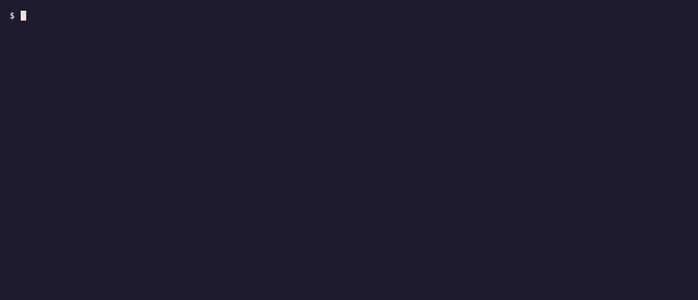

<h1 align="center">Agent Sandbox</h1>

<p align="center">
  <em>A sandbox for the commands that AI agents run: it checks each command against a written policy, explains every decision, limits what allowed commands can do, and keeps a log built to reveal later edits.</em>
</p>

<p align="center">
  <a href="https://github.com/adeoluo/agent-sandbox/actions/workflows/ci.yml"></a>
  <a href="https://github.com/adeoluo/agent-sandbox/releases"></a>
  
  <a href="LICENSE"></a>
</p>

---

> **Evidence level: unit tested.** The tests include hostile commands. In CI (the automated checks that run on every change), the suite also runs as the root user in three container setups (isolated Linux environments). No outside security audit has been done. No one else has reproduced the results, and the tool is not used in production. [What the levels mean](https://github.com/adeoluo#evidence-levels).

## Highlights

AI agents (programs in which a language model chooses the next action) can run commands on a
computer. This sandbox checks each command against a policy file before it runs and limits
what an allowed command can do. It is designed to stop a tricked agent from reading protected
keys or flooding the machine with processes.

- **All 38 hostile commands in the test suite were blocked.** They include deleting files,
  sending data over the network, reading SSH keys (keys for logging in to other machines) and
  hiding a path behind look-alike characters. Each one was denied before it could run.
- **A command that is not on the allowlist is rejected in about 8 millionths of a second.**
  The median time is 7.9 microseconds on an Apple M1 computer. Allowing `ls -la src` takes
  29.8 microseconds, because more checks on the file system are needed.
- **Without an operating-system sandbox, running a command through the sandbox adds about a
  thousandth of a second.** Compared with starting the command directly, the extra time is
  about 0.8 milliseconds. On macOS, switching on the built-in system sandbox adds about 8
  milliseconds more.
- **It caps runaway process floods ("fork bombs") even for the root user on Linux.** Linux
  ignores the usual per-user process limit for root, so the sandbox uses a kernel process
  counter (a cgroup) or its own fork gate instead. In a test that tried to keep 48 processes
  under a limit of 8, the highest count measured was 8.
- **It fails safe when it cannot enforce the process limit.** If a policy sets a process
  limit and nothing on the machine can enforce it, the command is not started and the refusal
  is recorded in the audit log, if one is set. A policy can also require the operating-system
  sandbox, and then commands are refused where that sandbox is missing.

**Where it falls short:** for the root user on Linux, the process limit needs Linux 5.5 or
newer when no cgroup can be created. The root process limit has not been tested under
gVisor. No outside security team has audited the code. In the default `auto` mode, a machine without an
operating-system sandbox gets the policy checks only. The `inspect` command and the audit
log say so.

## Key terms

Plain definitions of the terms used in this README.

| Term | Meaning |
|---|---|
| Adversarial command | A command written to cause harm or to escape the rules, such as deleting system files or reading secret keys. The test suite contains 38 of them. |
| Allowlist | The list of programs a policy permits. A program that is not on the list is denied by the `default-deny` rule. |
| Audit log | A file with one record per request. Each record holds a fingerprint (SHA-256 hash) of the record before it, so `audit verify` finds changed, deleted or reordered records. |
| cgroup v2 `pids.max` | A Linux kernel feature that puts processes in a group and sets the most tasks the group may hold. The kernel refuses new tasks above it, also for root. |
| Decision engine | The part of the sandbox that checks a request against the policy before anything runs. It returns allow or deny, the rule that decided, and a reason. |
| Decision latency | The time the decision engine needs to answer one request, in microseconds (us, millionths of a second). Lower is better. |
| Fork bomb | A command that copies itself again and again until the machine runs out of processes. |
| Fork gate | This project's safeguard for root on Linux. A seccomp filter pauses every request to create a process, and a supervisor allows it only while the group is under the limit. |
| gVisor | Google's sandboxed container runtime, which handles Linux system calls itself. The fork gate has not been tested on it. |
| Kernel | The core of the operating system. A rule enforced by the kernel holds for every program, including a shell started by an allowed command. |
| Landlock | A Linux kernel feature that lets a process restrict its own file access and, from version 4 of its interface (ABI 4), its TCP connections. |
| Line coverage | The share of source code lines that the tests run, from 0 to 100 percent; higher is better. CI fails below 85 percent. |
| Mean | The average of all measured times. Lower is better. |
| OS isolation backend | The operating-system sandbox applied to an allowed command: Seatbelt on macOS or Landlock on Linux. It limits writes and network access even inside `sh -c`. |
| p50, p95, p99 | Percentiles of the measured times: half the runs took at most the p50 time (the median), and 99 of 100 runs took at most the p99 time. Lower is better. |
| Policy | A configuration file (TOML or JSON) that lists what an agent may run, read, write and reach on the network, and its resource limits. |
| Process group | A set of processes that the operating system can signal as one. The sandbox uses it to stop a command together with all its children. |
| Property test | A test that checks a rule on many randomly generated inputs instead of a few fixed ones. Here each property test uses 256 inputs. |
| Read roots and writable roots | The folders a policy lets a command read from, and the folders it lets a command write to. Paths outside them are denied. |
| rlimit | A resource limit that the operating system applies to a process, for example CPU time (`RLIMIT_CPU`) or the number of processes (`RLIMIT_NPROC`). |
| Root (uid 0) | The administrator account on Unix systems. The kernel does not apply the per-user process limit (`RLIMIT_NPROC`) to it. |
| RSS | Resident set size: the memory a process actually holds. On macOS the sandbox watches it, because macOS rejects the usual memory limit. |
| Seatbelt (`sandbox-exec`) | The macOS kernel sandbox. `sandbox-exec` is the Apple command that starts a program under Seatbelt rules; Apple has deprecated it but still ships it. |
| seccomp | A Linux kernel feature that filters the system calls a process may make. With a user-notification listener, another thread decides each filtered call. |
| Spawn overhead | The extra time to start a command through the sandbox, compared with starting it directly, in milliseconds (ms, thousandths of a second). Lower is better. |

## Motivation

`agent-sandbox` sits between an agent and the operating system (OS). The agent asks, for example,
to run `rm -rf build/` or to read `~/.ssh/id_ed25519`. The sandbox checks the request against
a policy file and returns **allow or deny with the rule that decided and a reason**. It runs
allowed commands under resource limits and an OS isolation backend. When an audit log is set,
it adds the decision and the outcome to that log. The log uses JSON Lines (one JSON record
per line), and each record is linked to the one before it by a hash.

It comes in three forms. The first is a command-line tool (CLI):
`agent-sandbox run | check | audit verify | serve | inspect`. The second is a Rust library.
The third is a JSON Lines protocol over standard input and output (stdio). With the protocol,
agents written in Python, TypeScript or any other language can start the sandbox as a child
process and send it requests.

Agents that can run shell commands are useful and risky at the same time. The usual choices
are to trust the model or to run everything in a virtual machine (VM). A **policy layer** sits
between those two. It is a reviewed file under version control that says what one kind of
agent may do. The sandbox checks it on every call and keeps a record of what happened. This
project builds that layer as a usable tool. It also states clearly which rules the kernel
enforces and which rely only on checking the command's arguments.

## Architecture

<p align="center">
  
</p>

<sub>Legend: amber marks entry points and external systems, indigo marks core logic, green marks data and state, blue marks validation and control, and grey marks monitoring and outputs.</sub>

An agent reaches the sandbox in one of three ways: the CLI, the JSON Lines protocol over stdio,
or the Rust library. All three call the same `Sandbox` API. The decision engine checks each
request against the compiled policy. It resolves every argument that looks like a path and
matches the argument patterns. When an audit log is set, each denial is written to it with its
rule and reason. Allowed file reads and writes happen inside the sandbox process itself. They
use `O_NOFOLLOW` (an open flag that refuses a symbolic link as the final part of the path) and
size caps. Allowed commands run as a child process under rlimits (per-process resource
limits), a timeout, output caps and the OS isolation backend. When an audit log is set, every
outcome is added to it. Each record is linked by a SHA-256 hash (a standard cryptographic
fingerprint), and `audit verify` checks the chain. The diagram source is
[`docs/architecture/architecture.mmd`](docs/architecture/architecture.mmd). The module
walkthrough and the request sequence diagram are in [`docs/ARCHITECTURE.md`](docs/ARCHITECTURE.md).

Two layers enforce the policy. The reasons are in
[ADR 0001](docs/adr/0001-two-layer-enforcement.md), an architecture decision record (ADR): a
short document that explains one design choice.

1. The **decision engine** checks a request before anything runs. It checks the program
   against the allowlist and pins it to the binary found on the policy `PATH` (the folders the
   policy searches for programs). It checks the
   allow and deny patterns for that program's arguments and the globally denied arguments. It
   applies the file system rules to every argument that can name a path, and simple network
   rules of thumb. It returns the rule that decided.
2. The **child process boundary** limits what an allowed command can do. It applies
   rlimits, a wall-clock timeout that kills the whole process group, output caps and a
   cleaned environment (only allowed variables are passed on). It also applies the OS
   isolation backend: Seatbelt (the macOS kernel sandbox) through `sandbox-exec` on macOS, or
   Landlock (a Linux kernel sandbox feature) on Linux. The backend confines writes and network
   access even inside `sh -c`.

## Results

The main numbers are listed here. The sections below give the details.

- Decision latency on an Apple M1: the median (p50) is 7.9 microseconds (us) for a request
  denied at the allowlist, and 29.8 us for an allowed `ls -la src`. Each additional path
  argument adds about 10 us.
- Spawn overhead compared with a bare `Command` (starting the program directly from Rust):
  about 0.8 milliseconds (ms) without an OS isolation backend. On macOS, `sandbox-exec` adds
  about 8.4 ms more, compared with the same run with isolation off. On Linux, Landlock adds
  no measurable extra cost.
- All 38 adversarial agent commands were denied. Some tests use a policy that allows an
  interpreter (a program such as `sh` or `perl` that runs other code). In those tests, the
  kernel still blocked writes outside the scratch folder, reads of `~/.ssh` and TCP
  connections (TCP is the protocol behind most internet connections), on both CI platforms.
- 101 tests pass on `ubuntu-latest` (the Linux CI machine) and 95 on `macos-latest` (the macOS
  CI machine). The difference is the six
  fork-gate and root process-limit tests, which run only on Linux. The suite also runs as
  `uid 0` (the root user) in three containers. Each container leaves one way to handle the
  process limit. CI fails if line coverage drops below 85 percent.

### Benchmarks

`make latency` (a target of the project's Makefile, run with the make build tool) runs
[`examples/latency.rs`](examples/latency.rs). It makes an optimized release build,
warms up, and then takes 20,000 decision samples and 500 spawn samples per row. `make bench`
runs an equivalent suite with Criterion (a Rust benchmarking library) in
[`benches/sandbox.rs`](benches/sandbox.rs).

**macOS**, Apple M1 (8 cores, 8 GB), macOS 27.0.1, Rust 1.99.1. The benchmark ran three
times. The median (p50) changed by less than 1 percent between runs, and the table shows the
middle run.

Each row is one operation: a decision (`decide`) or starting a command (`spawn`). The columns
give the median (p50), the 95th and 99th percentiles, and the mean time, in microseconds (us)
or milliseconds (ms). Lower is better.

| Operation | p50 | p95 | p99 | mean |
|---|---:|---:|---:|---:|
| decide: allow `ls -la src` | 29.8 us | 37.5 us | 73.0 us | 31.7 us |
| decide: deny unlisted `python3` | 7.9 us | 8.5 us | 17.0 us | 8.3 us |
| decide: deny `cat ~/.ssh/id_ed25519` | 24.9 us | 29.7 us | 68.0 us | 26.7 us |
| decide: allow `cat` with 9 path args | 113.4 us | 127.6 us | 184.8 us | 116.8 us |
| spawn: bare `Command::output` of `/bin/echo` | 1.12 ms | 1.64 ms | 1.87 ms | 1.19 ms |
| spawn: sandbox run, isolation off | 1.89 ms | 2.69 ms | 2.84 ms | 2.02 ms |
| spawn: sandbox run, isolation auto (`sandbox-exec`) | 10.27 ms | 10.65 ms | 10.87 ms | 10.16 ms |

**Linux**, `ubuntu-latest` on GitHub Actions (GitHub's CI service): Ubuntu 26.04, x86_64 processor, shared runner. The numbers
come from one run in the CI log, with 10,000 decision samples and 250 spawn samples per row
(`latency 1000`). Shared runners give noisier timings than a dedicated machine.

The Linux table has the same rows and columns as the macOS table. Lower is better.

| Operation | p50 | p95 | p99 | mean |
|---|---:|---:|---:|---:|
| decide: allow `ls -la src` | 46.3 us | 55.3 us | 67.5 us | 47.2 us |
| decide: deny unlisted `python3` | 12.8 us | 13.6 us | 21.5 us | 13.1 us |
| decide: deny `cat ~/.ssh/id_ed25519` | 36.4 us | 38.4 us | 46.4 us | 36.9 us |
| decide: allow `cat` with 9 path args | 188.0 us | 198.7 us | 215.0 us | 190.7 us |
| spawn: bare `Command::output` of `/bin/echo` | 2.23 ms | 2.32 ms | 2.37 ms | 2.24 ms |
| spawn: sandbox run, isolation off | 2.96 ms | 3.07 ms | 3.30 ms | 2.96 ms |
| spawn: sandbox run, isolation auto (`landlock-abi-8`) | 2.88 ms | 2.98 ms | 3.05 ms | 2.89 ms |

Reading the numbers:

- Most of the decision time goes to file system calls to the kernel, not to pattern matching.
  The engine resolves the working folder and finds the program on the policy `PATH`. It also
  follows every path-like argument with `lstat` and `readlink` (calls that read file details
  and link targets). A denial that stops at the allowlist costs 8 us on the M1. Each path
  argument adds about 10 us.
- Without an OS isolation backend, the sandbox adds about 0.7 to 0.8 ms per started command,
  compared with a bare `Command`. This time covers the decision, building the environment
  and planning the rlimits, including the process count for `RLIMIT_NPROC`. It also covers
  the threads that read the output and the final sweep of the process group.
- Landlock adds no measurable start-up cost on Linux: the `auto` row is within noise of the
  `off` row. Setting up its rules takes a handful of system calls in the parent and two in
  the child.
- `sandbox-exec` adds about 8.4 ms per started command on macOS, because it compiles the
  profile and then starts (`exec`s) the target program. That is the cost of kernel-enforced
  write and network confinement on macOS. Setting `isolation.mode = "off"` removes it where
  checks by the engine alone are acceptable.

### Enforcement per OS

This table is the contract: it states what is enforced, and by what. `agent-sandbox inspect`
prints the same information for the current machine. When an audit log is set, every run
also records it there.

Each row is one control. The columns are macOS with `sandbox-exec`, Linux with Landlock, and
either system with no backend. "kernel" means the operating system enforces the control for
every process the command starts. "engine" means only the decision engine checks the command
before it runs, which is weaker.

| Control | macOS (sandbox-exec available) | Linux (Landlock available) | Either OS, no backend |
|---|---|---|---|
| Executable allowlist, argument patterns | engine | engine | engine |
| Path arguments vs. roots and denied paths | engine | engine | engine |
| Writes outside writable roots, from any process (including `sh -c`) | **kernel** (Seatbelt) | **kernel** (Landlock) | not enforced |
| Reads outside read roots, from any process | not enforced (engine only) | **kernel** | not enforced |
| Reads of `denied_paths`, from any process | **kernel** | kernel only if outside every read root | not enforced |
| Network | **kernel**: all network operations denied | **kernel**: TCP bind and connect denied (Landlock ABI 4+); UDP and raw sockets not covered | engine heuristics only |
| Proxy variables (`*_proxy`) | removed | removed | removed |
| Environment | allowlist only | allowlist only | allowlist only |
| Wall-clock timeout | process group SIGKILL | process group SIGKILL | same |
| CPU time | `RLIMIT_CPU` | `RLIMIT_CPU` | same |
| Memory | RSS watchdog over the process group, sampled every 5 ms (macOS rejects `RLIMIT_AS` with `EINVAL`) | `RLIMIT_AS` per process | same as the OS column |
| Process count | `RLIMIT_NPROC` (per user, set to current count plus `max_processes`); as `uid 0`, which the kernel exempts, commands are refused | `RLIMIT_NPROC`, plus a `cgroup v2 pids.max` leaf when one can be created. As `uid 0`: the `pids.max` leaf, else a seccomp fork gate, else commands are refused (see [Process limit for root](#process-limit-for-root)) | same |
| File size, open files | `RLIMIT_FSIZE`, `RLIMIT_NOFILE` | `RLIMIT_FSIZE`, `RLIMIT_NOFILE` | same |
| Output size | capped per stream; producer killed by default | same | same |
| Leftover background processes | process group swept with SIGKILL after exit | `cgroup.kill` (when cgroup v2 active) + process group swept with SIGKILL | process group swept with SIGKILL |

CI confirmed the backends: `ubuntu-latest` (Ubuntu 26.04) reports `landlock-abi-8`, and
`macos-latest` reports `sandbox-exec`. The adversarial tests that need a backend ran on both,
and none were skipped.

## Quickstart

### Install

From source (Rust 1.85 or newer):

```bash
git clone https://github.com/adeoluo/agent-sandbox && cd agent-sandbox
cargo install --path .
```

Prebuilt binary for macOS on Apple silicon, from the
[v0.1.0 release](https://github.com/adeoluo/agent-sandbox/releases/tag/v0.1.0):

```bash
curl -LO https://github.com/adeoluo/agent-sandbox/releases/download/v0.1.0/agent-sandbox-v0.1.0-aarch64-apple-darwin.tar.gz
curl -LO https://github.com/adeoluo/agent-sandbox/releases/download/v0.1.0/SHA256SUMS
shasum -a 256 --ignore-missing -c SHA256SUMS
tar xzf agent-sandbox-v0.1.0-aarch64-apple-darwin.tar.gz && ./agent-sandbox --version
```

On Linux, build from source. [Limitations](#limitations) explains why the v0.1.0 release has
no Linux binary.

### First commands

```bash
# What does this machine enforce for the sample policy?
agent-sandbox inspect --policy policies/coding-agent.toml

# Ask before running.
agent-sandbox check --policy policies/coding-agent.toml -- rm -rf /
# DENY filesystem.writable_roots: / resolves to / which is outside every writable root

agent-sandbox check --policy policies/coding-agent.toml -- cat ~/.ssh/id_ed25519
# DENY filesystem.denied_paths[/Users/you/.ssh]: /Users/you/.ssh/id_ed25519 resolves to ... which is denied

agent-sandbox check --policy policies/coding-agent.toml -- curl https://example.com
# DENY network.deny: curl is a network client and the network policy is deny

# Run under the policy, with an audit log.
agent-sandbox run --policy policies/coding-agent.toml --audit audit.jsonl -- ls -la src
agent-sandbox audit verify audit.jsonl
# OK 1 records, head 4b6f43e6...
```

## Usage

The recording below shows a real run. The coding-agent policy denies two requests: reading a
credential file and starting a network client. Then one allowed command runs, an audit record
is written, and the hash chain is verified. To record it again, run
`vhs docs/demo/sandbox.tape` (vhs is a tool that records terminal sessions).

<p align="center">
  
</p>

### Policy reference

A policy is a TOML or JSON file (two common configuration file formats). The sandbox rejects
unknown keys, so a typo cannot quietly weaken a rule. Paths may use `~`, `{workspace}`,
`{scratch}`, and `{home}` as placeholders. Relative paths start from the workspace folder,
which is set with `--workspace` and defaults to the current folder.

```toml
name = "coding-agent"

[filesystem]
read_roots     = ["{workspace}", "/usr", "/bin", "/lib", "/etc"]   # missing roots are skipped
writable_roots = []                                                 # scratch is added automatically
scratch_dir    = "{workspace}/.sandbox-scratch"                     # created if missing
denied_paths   = ["~/.ssh", "~/.aws", "{workspace}/.env"]           # never readable or writable

[network]
mode = "deny"              # deny (default) | allow
clients = ["my-uploader"]  # extra executables treated as network clients

[env]
allow = ["LANG", "LC_*", "TERM"]   # copied from the caller; everything else is dropped
path  = ["/usr/bin", "/bin"]       # where allowlisted binaries are found; exported as PATH
set   = { HOME = "{scratch}" }

[limits]
timeout_ms = 10000               # wall clock; kills the whole process group
cpu_seconds = 10                 # RLIMIT_CPU
memory_bytes = 1073741824        # RLIMIT_AS on Linux, RSS watchdog on macOS
max_output_bytes = 1048576       # per stream
kill_on_output_limit = true
max_processes = 64               # RLIMIT_NPROC headroom above the caller's count; see "Process limit for root"
max_file_size_bytes = 104857600  # RLIMIT_FSIZE, and the cap for write_file
max_open_files = 256             # RLIMIT_NOFILE

[isolation]
mode = "auto"              # auto | required | off

[deny]
args = ["--no-preserve-root"]
executables = ["sudo", "su", "chmod"]

[[exec]]
name = "git"
args_allow = ["status", "diff", "log", "-*"]   # if set, every argument must match one
args_deny  = ["push", "-c", "--upload-pack*"]  # any match denies
max_args = 8

[[exec]]
name = "rm"
writes = true              # every non-flag operand must resolve inside a writable root

[[exec]]
name = "list"
path = "/bin/ls"           # pin a binary instead of searching env.path
```

Patterns are globs (simple wildcard patterns). `*` matches any run of characters, `?` matches
exactly one character, and `\` escapes the next character. The matcher never backtracks
without limit: in the worst case, its time grows with the pattern length times the text
length. Full samples:
[`policies/coding-agent.toml`](policies/coding-agent.toml),
[`policies/readonly.toml`](policies/readonly.toml),
[`policies/readonly.json`](policies/readonly.json).

### How a request is decided

For a command request, `Exec { argv, cwd }`, the engine runs the checks below in order.
`argv` is the program name followed by its arguments, and `cwd` is the working folder. The
first check that fails is the rule reported in the decision. Each row is one step, and the
last column says when that step denies the request.

| Step | Rule name | Denies when |
|---|---|---|
| 1 | `exec.argv`, `exec.text` | argv is empty, over 128 KiB, or contains NUL, control, bidi, or zero-width characters |
| 2 | `filesystem.*` | the working directory resolves outside the readable roots or into a denied path |
| 3 | `deny.executables[x]` | the program is explicitly denied |
| 4 | `network.deny` | the network is denied and the program is a known network client (`curl`, `wget`, `nc`, `ssh`, ...) |
| 5 | `default-deny` | no `[[exec]]` rule names the program |
| 6 | `exec[x]` | the binary is not on the policy `PATH`, or an explicit path (`./scratch/ls`) is not the allowlisted binary |
| 7 | `exec[x].max_args`, `deny.args[p]`, `exec[x].args_deny[p]`, `exec[x].args_allow` | argument count or patterns fail |
| 8 | `network.deny` | the network is denied and an argument names a remote location (`://`, `git@`, `/dev/tcp/`) |
| 9 | `filesystem.text`, `filesystem.resolve`, `filesystem.denied_paths[p]`, `filesystem.read_roots`, `filesystem.writable_roots` | a path-like argument (including `--opt=PATH`, `-oPATH`, bare names that exist, and every operand of a `writes` command) fails the filesystem rules |

File requests, `Read { path }` and `Write { path }`, go straight to step 9. The engine
resolves a path one part at a time. It follows each symbolic link (a file that points to
another path) before it applies `..`. Because of this, `../`, absolute paths, linked folders,
dangling links (links whose target is missing) and link loops cannot lead outside the allowed
folders. The reasons are in [ADR 0002](docs/adr/0002-path-resolution.md).

### CLI

Each row is one command of the command-line tool, what it does, and the exit status it
returns.

| Command | Purpose | Exit status |
|---|---|---|
| `agent-sandbox run --policy P [--cwd D] [--dry-run] [--json] [--audit F] -- CMD ARGS` | decide and run | child's status; `126` denied; `124` timeout; `128+N` killed by signal N |
| `agent-sandbox check --policy P [--json] -- CMD ARGS` | decide only | `0` allow, `1` deny |
| `agent-sandbox check --policy P --read PATH` (or `--write PATH`) | decide a file operation | `0` allow, `1` deny |
| `agent-sandbox audit verify LOG [--expect-head HASH] [--json]` | verify the hash chain | `0` intact, `1` tampered |
| `agent-sandbox serve --policy P [--audit F]` | JSON Lines over stdio | `0` at EOF |
| `agent-sandbox inspect --policy P` | resolved policy and what this OS enforces | `0` |

Every command that takes a policy also accepts `--workspace DIR`. A usage error, such as a
missing option, exits with status `2`.

### JSON Lines over stdio

The client sends one request per line and gets one response per line, in the same order. A
request may include an `id`, and the response repeats it.

```text
-> {"id":1,"op":"check","argv":["rm","-rf","/"]}
<- {"id":1,"ok":true,"result":{"allowed":false,"rule":"filesystem.writable_roots","reason":"/ resolves to / which is outside every writable root"}}
-> {"id":2,"op":"run","argv":["ls","src"]}
<- {"id":2,"ok":true,"result":{"decision":{...},"executed":true,"exit_code":0,"stdout":"main.rs\n","timed_out":false,"enforcement":{"backend":"sandbox-exec",...},...}}
```

Each row is one operation (`op`), the fields it takes (`?` marks an optional field), and what
it returns.

| `op` | Fields | Result |
|---|---|---|
| `check` | `argv`, `cwd?` | decision |
| `check_read`, `check_write` | `path`, `cwd?` | decision |
| `run` | `argv`, `cwd?`, `stdin?`, `dry_run?` | run outcome (decision, exit code, signal, flags, capped output, enforcement) |
| `read_file` | `path`, `cwd?` | decision, `content`, `bytes`, `truncated` |
| `write_file` | `path`, `contents`, `cwd?` | decision, `bytes` |
| `policy` | none | resolved roots, executables, limits |

An error comes back as `{"id":..,"ok":false,"error":"..."}`.
[`examples/python_client.py`](examples/python_client.py) is a complete Python client, and
`make demo` runs it. Its output on the development machine:

```text
ALLOW ls src                           exec[ls]
DENY  curl https://example.com         network.deny
DENY  cat ~/.ssh/id_ed25519            filesystem.denied_paths[/Users/ade/.ssh]
run ls src -> exit 0, 114 bytes
enforced by: sandbox-exec
```

### Rust library

```rust
use agent_sandbox::{AuditLog, CompileOptions, CompiledPolicy, Request, RunOptions, Sandbox};

let opts = CompileOptions::from_env(None)?;
let policy = CompiledPolicy::load("policies/coding-agent.toml".as_ref(), &opts)?;
let sandbox = Sandbox::new(policy).with_audit(AuditLog::open("audit.jsonl")?);

let decision = sandbox.check(&Request::Read { path: "~/.ssh/id_ed25519".into(), cwd: None })?;
assert!(!decision.allowed);

let out = sandbox.run(&["git".into(), "status".into()], &RunOptions::default())?;
println!("{} -> {:?}", out.decision.rule, out.exit_code);
```

Callers that need only decisions, without running anything, can use `Engine::decide` on its
own.

### The audit log

Each line is one record, `{seq, ts_ms, prev_hash, event, hash}`. The fields are a sequence
number, a timestamp in milliseconds, the hash of the previous record, the event, and the
record's own hash. That hash is `hash = SHA-256(seq, ts_ms, prev_hash, canonical_json(event))`.
Canonical JSON writes the keys in sorted order, so the same event always gives the same hash.
Each event records the request, the decision, and the policy name and its SHA-256 hash. For a
command that ran, it also records the process ID (pid), exit status, flags, byte counts,
SHA-256 hashes of standard output and standard error, the duration, and the enforcement
report. The output itself is not stored. Each write takes a file lock (`flock`), so several
processes can share one log. The reasons are in [ADR 0003](docs/adr/0003-audit-hash-chain.md).

### Demos

These recordings come from real runs made with [vhs](https://github.com/charmbracelet/vhs), a
tool that records terminal sessions. Each recording script (tape) is in `docs/demo/`.

The first recording shows the resolved policy and what this operating system enforces for it.

<p align="center">
  
</p>

The second recording shows checks on file operations and a dry run (a decision without running
the command), with the full decision printed as JSON.

<p align="center">
  
</p>

## Design decisions

- [ADR 0001](docs/adr/0001-two-layer-enforcement.md): use two layers. A decision engine gives
  denials that can be explained, and an OS backend covers what checking the arguments (argv)
  cannot see.
- [ADR 0002](docs/adr/0002-path-resolution.md): resolve paths one part at a time, and follow
  symbolic links before applying `..`. Reject misleading Unicode characters, such as
  look-alike slashes, before resolving.
- [ADR 0003](docs/adr/0003-audit-hash-chain.md): use JSON Lines with a SHA-256 hash chain and
  canonical JSON. A head hash (the hash of the last record) stored elsewhere makes it possible
  to detect a log that was cut short.
- [ADR 0004](docs/adr/0004-os-backends.md): use Seatbelt on macOS and Landlock on Linux. It
  also explains why namespaces (separate views of the system for a process) are not the core
  in v0.1.
- [ADR 0005](docs/adr/0005-process-limit-for-root.md): for root, enforce the process limit with
  a `pids.max` cgroup or a seccomp fork gate. If neither works, refuse the command.

Other choices:

- The sandbox never starts a shell. It passes argv straight to `execve` (the system call that
  starts a program), so `;`, `|`, and `$()` in arguments are plain text with no effect.
- The program an agent names is pinned to the binary found on the policy `PATH`.
- The child gets its own process group, so timeouts and cleanup also reach its own children.
- Unknown policy keys are errors.

## Testing

```bash
make test        # cargo test --all-targets
make coverage    # cargo llvm-cov with an 85 percent line gate
make lint        # cargo fmt --check and cargo clippy --all-targets -D warnings
```

Linux runs 101 tests: 19 unit tests, 81 integration tests and 1 documentation test. macOS runs
95: 17 unit, 77 integration and 1 documentation test. Three of them are property tests with
256 cases each. All pass on `ubuntu-latest` and `macos-latest` in CI. The Linux suite also
runs again as `uid 0` inside three containers. The first has read-only cgroups, the second
has a delegated `pids` cgroup (one the container is allowed to manage), and the third has
neither mechanism.

Each row of the next table is one test file, with its number of tests and what it covers.

| Suite | Tests | What it covers |
|---|---:|---|
| `tests/policy_engine.rs` | 14 | a 35-row allow/deny matrix with the expected rule for each row; binary pinning (a copy of `ls` in scratch is not `ls`); parsing and validation errors; JSON and TOML loading |
| `tests/path_escape.rs` | 15 | `..` chains, absolute paths, symlinked files and directories, dangling links, link loops, symlink then `..`, tilde expansion, eight Unicode tricks (division slash, fullwidth solidus, one-dot leaders, fullwidth stops, RTL override, zero-width space, NUL, newline); property tests: the resolver equals `realpath(3)`, no allowed write leaves scratch, the engine is total on arbitrary argv |
| `tests/resource_limits.rs` | 14 | timeout kills `sleep 30` and its process group; background children reaped; `yes` stopped at the output cap; CPU limit stops a busy loop; a 1 GiB allocation is contained under a 128 MiB limit; a fork bomb is bounded and its group emptied; as root, a spawner asking for 48 tasks under a limit of 8 is sampled from outside and never holds more than 8; the suite asserts which mechanism enforced the limit; `RLIMIT_FSIZE`; stdin; environment scrubbing |
| `tests/forkgate.rs` | 3 | the seccomp fork gate driven directly, as any user: the group is held at the limit and the refused forks are counted; a command under the limit runs unchanged; `setpgid` is refused inside the gate |
| `tests/audit_chain.rs` | 12 | intact chains verify; floating-point event values re-hash identically after a parse; modified, recomputed, deleted, reordered, inserted, and malformed records are detected at the right line; truncation is detected with `--expect-head`; four concurrent writers keep one chain |
| `tests/adversarial.rs` | 7 | 38 known agent-misbehavior commands all denied (listed below); with `sh` and `perl` allowed, the OS backend blocks writes outside scratch, reads of `~/.ssh`, and a TCP connect to a local listener (with a control run that connects when the network is allowed) |
| `tests/interfaces.rs` | 12 | CLI exit codes and messages, `--json`, `--dry-run`, `audit verify` on a tampered log, `inspect`, `serve` driven from another process, every stdio `op`, malformed input |
| `tests/isolation.rs` | 4 | backend selection for `off`, `auto`, `required`; generated Seatbelt profile content |

The adversarial list includes the following commands: `rm -rf /`, `rm -rf ~`, `rm -rf scratch/../src`,
`rm -r -- -rf ../outside`, `find / -delete`, `find . -exec rm`, `curl -d @/etc/passwd`,
`wget ... payload.sh`, `nc`, `ssh`, `scp`, `git push https://...`, `cat /dev/tcp/...`,
`cat ~/.ssh/id_ed25519`, `cat ~/.aws/credentials`, `grep -r KEY ~/.ssh`, `cat .env`,
`cat /etc/shadow`, `sudo`, `bash -c ':(){ :|:& };:'`, `python3 -c "os.system(...)"`,
`env rm -rf /`, `xargs rm`, `git -c core.sshCommand=sh`, `git --upload-pack=...`,
`cat ..∕..∕etc∕passwd` (U+2215, a division slash that looks like `/`), an RTL-override
argument (a hidden character that reverses the direction of the text), `/bin/sh -c id`, and
`./scratch/ls`.

Line coverage, measured with `cargo llvm-cov` (a Rust code coverage tool), is **95.2 percent
on macOS** (measured locally) and **93.2 percent on Linux** (measured in CI). Higher is
better, and CI fails below 85 percent. The lowest file is `isolation/mod.rs`, at 76 to 79
percent, because each operating system runs only its own backend code.

## Responsible AI

- **Threat model:** [docs/THREAT_MODEL.md](docs/THREAT_MODEL.md) lists what needs protection
  (assets), the points where trust changes (trust boundaries), the threats, the defenses
  against them (mitigations) and the risk that remains (residual risk).
- **Standards:** the [threat model](docs/THREAT_MODEL.md#standards-mapping) maps every threat to
  three public lists of risks. The first is the OWASP Top 10 for Agentic Applications 2026.
  OWASP is a nonprofit that publishes security guidance. Examples are ASI02 Tool Misuse and
  Exploitation, ASI03 Identity and Privilege Abuse and ASI05 Unexpected Code Execution. The
  second is the OWASP Top 10 for LLM Applications 2026, for large language model (LLM)
  applications: LLM03:2026 Excessive Agency and LLM06:2026 Unbounded Consumption. The third is
  MITRE ATLAS v2026.10, a public catalog of attack techniques against AI systems. Examples are
  AML.T0053 AI Agent Tool Invocation and AML.T0086 Exfiltration via AI Agent Tool Invocation.
- **Inert tests:** the adversarial suite uses reserved `.example` host names, which never
  point to real servers, a local TCP listener and test folders (fixtures). Commands that the
  engine denies are never run.
- **Scope:** the sandbox limits what a manipulated agent can do. It does not detect prompt
  injection (hidden instructions in text that the model reads). It does not replace human
  review of actions with serious consequences.

## Process limit for root

`max_processes` is a strict upper limit only if the kernel enforces it before a new task (a
process or thread) exists. For ordinary users, `RLIMIT_NPROC` does this. The kernel does not
apply it to `uid 0`, and agents inside containers usually run as `uid 0`. So for root, the
sandbox picks the first mechanism in the table below that works. It records the choice in
`enforcement.processes` in the audit log.

Each row is one mechanism, in the order the sandbox tries them, with when it applies and how
it enforces the limit.

| Order | Mechanism | When it applies | How it is enforced |
|---|---|---|---|
| 1 | cgroup v2 `pids.max` | a leaf cgroup of type `domain` with `pids.max` can be created under the caller's cgroup or beside it | the leaf is created before the command is spawned and the forked child joins it before `exec`, so no task of the command ever runs outside it; `cgroup.kill` empties it afterwards |
| 2 | seccomp fork gate ([`src/forkgate.rs`](src/forkgate.rs)) | Linux 5.5 or newer on x86-64 or arm64, and the runtime allows a seccomp user-notification listener (Docker's default profile does) | every `clone`, `clone3`, `fork` and `vfork` by the command or a descendant blocks in the kernel while a supervisor thread counts the live tasks of the process group, then continues or fails with `EAGAIN`; `setsid` and `setpgid` return `EPERM` so tasks cannot leave the counted group; other architectures' system calls are refused |
| 3 | none | neither of the above (and always on macOS as root) | the command is not started: `run` returns `LimitUnenforceable` and the refusal is audited |

There is no fallback that checks the process count from time to time (polling). An earlier
version watched `/proc` (the Linux folder that lists running processes) from the parent. It
killed the group after the group grew past the limit. That approach reacts only after the
fact and depends on how fast the host answers `/proc`. With it, an outside reviewer saw a
program that spawns 48 processes finish under a limit of 8. It was removed rather than tuned.

CI runs the whole suite as `uid 0` in three containers, one for each row. Each run checks
that the expected mechanism was the one used (`AGENT_SANDBOX_EXPECT_PROCESS_CAP`). The
commands are:

```bash
# 2: read-only cgroups (the default for containers), fork gate
docker run --rm -v "$PWD":/src -w /src rust:1-slim sh -c \
  'apt-get update -qq && apt-get install -y -qq procps perl git && cargo test --all-targets'
# 1: delegated pids cgroup
docker run --rm --privileged --cgroupns=private -v "$PWD":/src -w /src rust:1-slim sh -c \
  'apt-get update -qq && apt-get install -y -qq procps perl git &&
   mkdir /sys/fs/cgroup/runner && echo $$ > /sys/fs/cgroup/runner/cgroup.procs &&
   echo +pids > /sys/fs/cgroup/cgroup.subtree_control && cargo test --all-targets'
# 3: no listener and no cgroup, commands refused
docker run --rm --security-opt seccomp=ci/seccomp-no-listener.json -v "$PWD":/src -w /src \
  rust:1-slim sh -c \
  'apt-get update -qq && apt-get install -y -qq procps perl git && cargo test --all-targets'
```

In the first two containers, the test `root_process_cap_is_never_exceeded` starts a shell that
tries to keep 48 background child processes under a limit of 8. Another thread counts the
processes in the group while it runs. The highest count was 8 with either mechanism, on
Linux 7.0 (arm64, Docker Desktop). The gate has not been run under gVisor or on kernels older
than 5.5. Both cases are expected to fall to row 3.

## Limitations

These limits are stated plainly, because a sandbox that claims more than it does is worse
than none.

- **Allowing an interpreter leaves protection to the OS backend.** A policy may allow `sh`,
  `python3`, `node`, `make`, `git` with hooks (scripts that git runs on certain events), or
  any other tool that runs other programs. The engine cannot see what that tool then does.
  When a backend is active, the kernel still confines writes and network access, but on Linux
  only TCP network access. On macOS, reads outside the read roots are not confined. With no
  backend, an allowed interpreter can do anything the user can.
- **Argument checks rely on rules of thumb.** The engine treats these arguments as paths:
  arguments that look like paths, `--opt=PATH`, `-oPATH`, bare names that exist, and every
  operand of a `writes` command. A tool that takes a path in an unusual form, for example
  `tar -C dir`, needs an `args_deny` or `writes = true` rule to be covered. Keep allowlists
  narrow.
- **Network on Linux:** the kernel blocks TCP only, and only with Landlock ABI 4 (Linux 6.7
  or newer). It does not block UDP, ICMP or Unix sockets (other kinds of network and local
  connections). On older kernels, only the engine checks network use, and `inspect` says so.
  Removing proxy variables is good practice, not enforcement.
- **macOS `sandbox-exec`** is deprecated by Apple, although it still ships and works on macOS
  27. It cannot run inside another sandbox. If the caller is already sandboxed, the start-up
  test (probe) fails. Then `auto` mode falls back to checks by the engine only, and `required`
  mode refuses to run.
- **`denied_paths` on Linux** are enforced by the kernel only if they lie outside every read
  root, because Landlock rules can only grant access. Inside a read root, only the engine
  checks them.
- **Memory**: on Linux, `RLIMIT_AS` limits the virtual address space of each process. That is
  not the memory actually in use (resident memory), and it can break runtimes that reserve
  large address ranges. On macOS, the watchdog checks RSS every 5 ms, so a very fast
  allocation can get ahead of it.
- **`RLIMIT_NPROC` is per user**, not per sandbox. The sandbox sets it to the user's current
  process count plus `max_processes`. Other processes that the same user starts at the same
  time therefore change the room that is left. Where a `pids.max` leaf (a child cgroup) can be
  created, the command also joins it before `exec`.
- **Process limit for root**: the kernel does not apply `RLIMIT_NPROC` to `uid 0`. For root,
  the limit is therefore enforced another way or not at all, as described in
  [Process limit for root](#process-limit-for-root). The fork gate scans `/proc` once for each
  new task, which takes about a millisecond in a small container. It also refuses `setsid` and
  `setpgid`. This breaks commands that turn themselves into background services (daemonize)
  or manage job control. On macOS as root, a policy that sets `max_processes` cannot run
  commands. The same holds on Linux hosts with neither mechanism: kernels before 5.5, or
  runtimes that do not implement seccomp listeners.
- **Fork-bomb cleanup on macOS**: the sandbox sends SIGKILL (the signal that stops a process
  at once) to the group again and again, for up to 5 seconds. On a busy macOS CI runner, a few
  killed processes have stayed in the kernel's exit path for several seconds after `run`
  returns. They no longer create new processes, and the test limits how many there may be. On
  Linux, the group is empty when `run` returns.
- **Process-group escape**: a child that calls `setsid` (which starts a new session) leaves
  the process group. The timeout and the cleanup sweep then do not kill it, although Landlock
  and Seatbelt still apply to it. This holds on macOS, and for non-root users on Linux without
  a `pids.max` leaf. With a leaf, `cgroup.kill` also ends sessions that left the group. Under
  the fork gate, `setsid` is refused, so there is nothing to escape to.
- **Time of check to time of use (TOCTOU)**: a path can change after the engine checks it and
  before the child opens it. The file API opens the last part of the path with `O_NOFOLLOW`,
  and the OS backends check writes again in the kernel. Path checks do not detect hard links
  (second names for the same file) to files outside the roots.
- **Audit log**: the log is tamper-evident only relative to a head hash stored elsewhere. It
  is not tamper-proof: a writer with full access to the file can rewrite the whole chain.
  Head hashes are not signed.
- **Platforms**: Unix systems only. Windows is not supported.
- **Release binaries**: v0.1.0 ships only a macOS arm64 binary and a source archive (tarball).
  The local build setup is Homebrew Rust without `rustup` (the Rust toolchain installer). So
  no Linux standard library was available to build a Linux binary on the Mac
  (cross-compilation).

## Roadmap

- An optional Linux namespace backend where unprivileged user namespaces are permitted.
  Namespaces give a process its own view of users, mounts, the network and process IDs (PID).
  The backend would mount the roots read-only and give the command an empty network
  namespace.
- A seccomp filter for the socket families that Landlock does not cover (UDP and raw sockets).
- Argument descriptions (schemas) for each tool (`tar`, `git`, `find`) in place of glob lists.
- Signed audit heads and a streaming verifier.
- Linux release binaries built in CI.
- Memory limits with cgroup v2 `memory.max`, next to the existing `pids.max` leaf, when
  delegated cgroups are available.

### Contributing and security

See [CONTRIBUTING.md](CONTRIBUTING.md) and [SECURITY.md](SECURITY.md).

## License

Released under the [MIT License](LICENSE).
