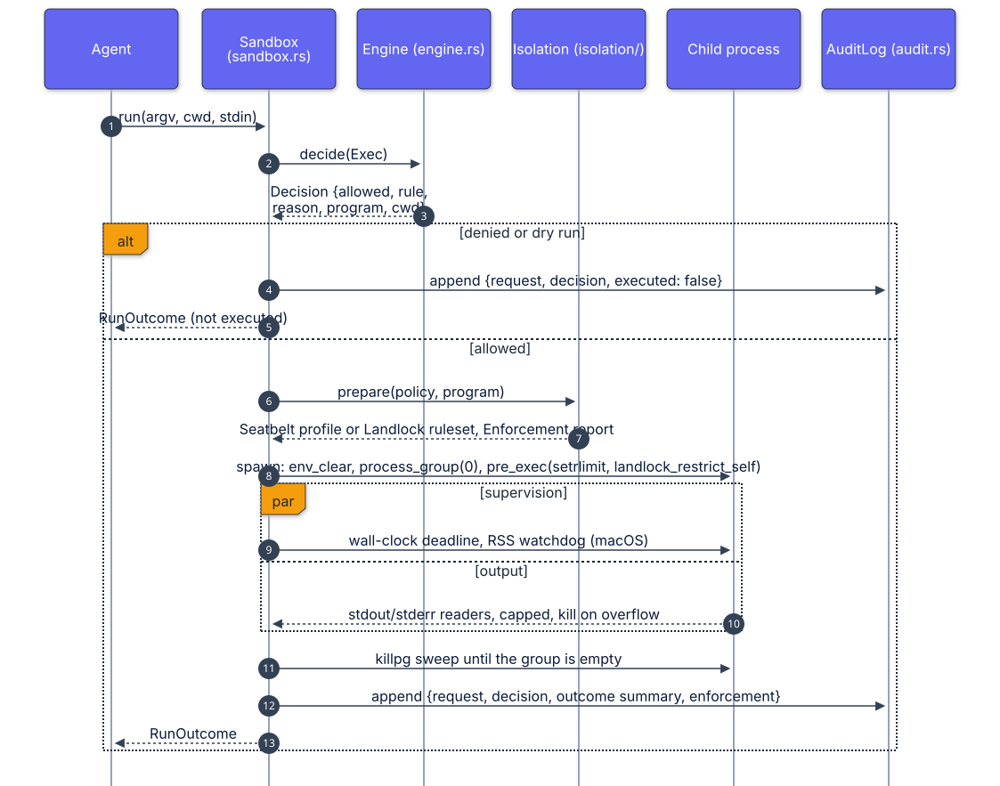

# Architecture

This document walks through the modules, the request lifecycle, and the trust boundaries.
The decisions behind them are in [`adr/`](adr/).

## Request lifecycle

  

## Modules

| Module | Responsibility |
|---|---|
| `policy.rs` | The on-disk schema (`Policy`, `deny_unknown_fields` everywhere), validation, and compilation into `CompiledPolicy`: placeholder expansion, resolution of every root, scratch directory creation, policy SHA-256. |
| `paths.rs` | Text checks for deceptive characters, `~` and placeholder expansion, and `resolve`, the component-wise symlink-aware resolver ([ADR 0002](adr/0002-path-resolution.md)). |
| `pattern.rs` | Glob matcher (`*`, `?`, `\`) with linear-time two-pointer matching, used for argument and environment patterns. |
| `engine.rs` | `Engine::decide(&Request) -> Decision`. Pure apart from `stat`/`readlink`. Holds the ordered checks listed in the README. |
| `limits.rs` | Plans rlimits in the parent (clamped to current hard limits), applies them in the child, counts the user's processes for `RLIMIT_NPROC` headroom, and samples process-group RSS on macOS. |
| `isolation/mod.rs` | Chooses a backend according to `isolation.mode` and produces the `Enforcement` report. |
| `isolation/macos.rs` | Generates the Seatbelt profile and probes whether `sandbox-exec` works here. |
| `isolation/linux.rs` | Builds a Landlock ruleset with raw syscalls in the parent; `restrict_self` runs in the child. |
| `sandbox.rs` | `Sandbox`: `check`, `run`, `read_file`, `write_file`; environment construction; spawning and supervision; audit records. |
| `audit.rs` | Append-only JSON Lines with a SHA-256 chain, `flock` for concurrent writers, and `verify` ([ADR 0003](adr/0003-audit-hash-chain.md)). |
| `server.rs` | JSON Lines protocol over any `BufRead`/`Write` pair. |
| `main.rs` | The `clap` CLI. |

## Trust boundaries

1. **Agent to sandbox.** Everything the agent sends is untrusted: argv strings, paths,
   stdin, file contents. The engine treats any argument that can name a file as a path and
   checks it after full resolution. Text that renders differently from what the kernel
   sees is rejected.
2. **Policy file.** Trusted, but validated: unknown keys, relative pinned paths, empty
   names, zero limits, deceptive characters, and a writable root of `/` are errors.
3. **Sandbox to child.** The child receives a clean environment, a resolved absolute
   program path, its own process group, rlimits, and (when available) a kernel sandbox it
   cannot remove. The parent never runs a shell.
4. **Audit log.** Written only by the sandbox; verifiable by anyone with the file and,
   for truncation, an externally stored head hash.

## Process supervision details

- `process_group(0)` puts the child in a new group whose id equals its pid. Timeouts,
  memory and output violations, and post-exit cleanup all use `killpg(SIGKILL)`.
- A dedicated thread calls `wait`; the supervising thread waits on a channel with the
  remaining deadline (or a 5 ms poll when the macOS RSS watchdog is active).
- Each output stream is read by its own thread into a buffer capped at
  `max_output_bytes`. Bytes beyond the cap are counted but discarded; by default the group
  is killed on overflow so a producer like `yes` stops immediately.
- After the child exits, the group is signalled repeatedly until `killpg` reports `ESRCH`
  (bounded at 5 seconds), so background processes and fork-bomb members are removed even
  if a `fork` was in flight during the first signal.

## Platform matrix

The per-OS table in the README is the source of truth for what is enforced where. At
runtime, `agent-sandbox inspect` and the `enforcement` field of every execution report
the same information for the actual machine.
